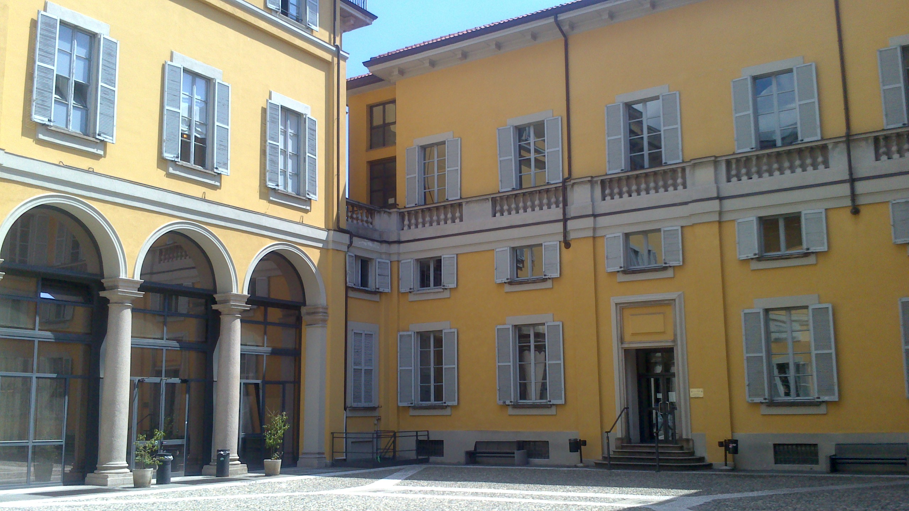

# mattiaspagnoloo.github.io

Hello everyone! 
My name is Mattia and I am 22 years old.
I am from [Salento](https://www.instagram.com/reel/DaQBVl1Ni8m/) and I graduated in Digital Management in July, now I am pursuing a Master's Degree in Corporate Communication at Università degli Studi di Milano.

## Web Communication Course Links

* **[Course Repository (learn-web)](https://github.com/ale66/learn-web):** official repository containing lecture notes, slides, coding examples, and guidelines for the WebCom course.
* **[Class Playground (2026–27)](https://github.com/ale66/learn-web-playground-2026-27):** shared workspace for class exercises.
* **[Personal Refactoring Project](https://github.com/ale66/learn-web-playground-2026-27/tree/main/essays/mattiaspagnoloo):** My own web refactoring project featuring COM.

## Campus

This is our Campus in Via Conservatorio

